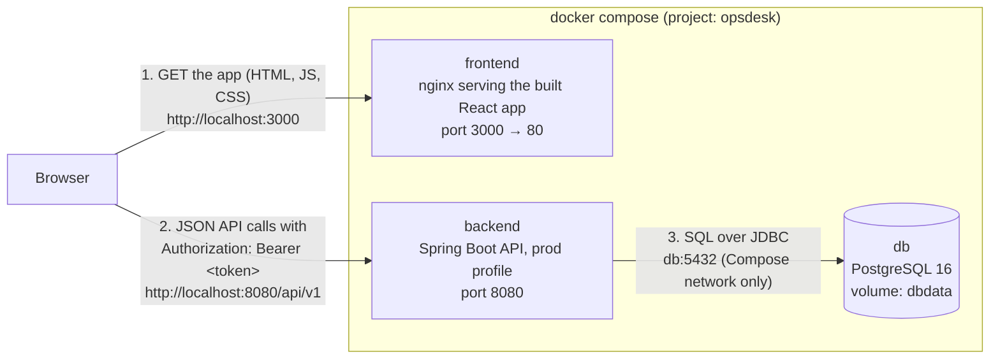

# OpsDesk

[](https://github.com/Jesutofunmiabby/opsdesk-backend/actions/workflows/ci.yml)
[](https://github.com/Jesutofunmiabby/opsdesk-frontend/actions/workflows/ci.yml)

OpsDesk is an internal operations dashboard for an IT support team. Staff log
in, raise support tickets, and follow them from open to closed on a board or
a searchable list. Managers assign tickets to agents, and admins look after
user accounts. A dashboard sums it all up.

This repository ties the system together: it starts the database, the API and
the web app with one command, and holds the documentation for the whole
project. The code lives in two other repositories:

| Repository | What it holds |
| --- | --- |
| [opsdesk-frontend](https://github.com/Jesutofunmiabby/opsdesk-frontend) | The web app: React 19, TypeScript and Vite, served by nginx |
| [opsdesk-backend](https://github.com/Jesutofunmiabby/opsdesk-backend) | The REST API: Java 25, Spring Boot 4, Spring Security with JWT, PostgreSQL |
| **opsdesk-system** (this one) | `docker-compose.yml`, the settings template and this guide |

## Contents

- [Features](#features)
- [Architecture](#architecture)
- [Run it](#run-it)
- [Environment variables](#environment-variables)
- [Make the first admin](#make-the-first-admin)
- [API documentation (Swagger)](#api-documentation-swagger)
- [Run the tests](#run-the-tests)
- [Develop without Docker](#develop-without-docker)
- [Troubleshooting](#troubleshooting)

## Features

- **Accounts and login.** Anyone can register; every new account is a `USER`.
  Logging in gives a token that lasts 24 hours. Passwords are stored only as
  BCrypt hashes.
- **Four roles.** What each person may do is decided by the backend on every
  request, not just hidden in the app:

  | Action | ADMIN | MANAGER | AGENT | USER |
  | --- | --- | --- | --- | --- |
  | View tickets | all | all | all | own only |
  | Create a ticket | yes | yes | yes | yes |
  | Edit a ticket | any | any | assigned to them | own, while OPEN |
  | Assign a ticket | yes | yes | no | no |
  | Delete a ticket | yes | no | no | no |
  | List users | yes | yes | no | no |

- **Tickets.** Create, edit, assign and delete (with a confirmation) support
  tickets with a title, description, priority (LOW, MEDIUM, HIGH) and status
  (OPEN, IN_PROGRESS, RESOLVED, CLOSED).
- **Ticket board and list.** A board with a column per status and a
  **Move to next** button, and a list with title search, status filter and
  paging, all done by the server.
- **Dashboard.** Counts of tickets by status, and of employees, departments
  and user accounts.
- **Projects, Teams and Users.** Internal IT projects, a searchable staff
  directory, and the user accounts with their roles.
- **Careful UI.** Loading skeletons, empty and error states with Retry,
  notifications after every change, an error boundary, keyboard and screen
  reader support.
- **Live API documentation.** A Swagger page that describes every endpoint
  and lets you try it with your token.
- **Checked on every push.** Both code repositories run their tests on GitHub
  Actions for every pull request and every push to `main`.

Screenshots are in the
[frontend README](https://github.com/Jesutofunmiabby/opsdesk-frontend#screenshots).

## Architecture



What talks to what:

1. **Browser → frontend.** The browser loads the app from nginx on
   <http://localhost:3000>. nginx only serves files: the HTML, JavaScript and
   CSS that Vite built. Any other address, such as `/tickets/12`, gets
   `index.html`, so React Router can show the right page after a refresh.
2. **Browser → backend.** The app, now running in the browser, calls the API
   directly at `VITE_API_URL` (<http://localhost:8080/api/v1>). nginx does not
   pass these requests on. Because the app and the API are on different ports,
   they are different origins, so the backend must allow the app's address
   with CORS (`ALLOWED_ORIGIN`). Every call except register and login carries
   the login token.
3. **Backend → database.** Only the backend talks to PostgreSQL, over the
   network Compose creates, where the database's address is simply `db`. The
   database port is not published to your computer at all.

The backend waits to start until the database's health check
(`pg_isready`) passes. The database files live in the named volume `dbdata`,
so tickets and accounts survive `docker compose down` and rebuilds.

The full API, with every request, answer and error, is described in
[API_CONTRACT.md](https://github.com/Jesutofunmiabby/opsdesk-frontend/blob/main/API_CONTRACT.md),
which is the source of truth for both code repositories.

## Run it

### What you need

- **Git**, to clone the repositories. Check with `git --version`.
- **Docker Desktop**, running, with Docker Compose v2. Check with
  `docker compose version`. Nothing else: Java, Node and PostgreSQL all run
  inside the containers.
- Ports **3000** and **8080** free on your computer.

The commands below are for Git Bash, macOS or Linux. On Windows, Git Bash
comes with Git for Windows.

### 1. Clone the three repositories side by side

The compose file builds the backend and the frontend from `../opsdesk-backend`
and `../opsdesk-frontend`, so all three must sit in the same folder:

```bash
mkdir opsdesk && cd opsdesk
git clone https://github.com/Jesutofunmiabby/opsdesk-backend.git
git clone https://github.com/Jesutofunmiabby/opsdesk-frontend.git
git clone https://github.com/Jesutofunmiabby/opsdesk-system.git
```

```
opsdesk/
├── opsdesk-backend/
├── opsdesk-frontend/
└── opsdesk-system/      ← run docker compose here
```

### 2. Create the settings file

```bash
cd opsdesk-system
cp .env.example .env
```

Open `.env` and replace the two `change-me` values:

- `DB_PASSWORD`: any password for the database.
- `JWT_SECRET`: a random value of at least 32 characters. Make one with:

  ```bash
  openssl rand -base64 48
  ```

The other values can stay as they are. `.env` is ignored by Git, so your
secrets are never committed. Every variable is explained in
[Environment variables](#environment-variables).

### 3. Build and start everything

```bash
docker compose up --build
```

The first time takes a few minutes: Docker downloads PostgreSQL, Java and
Node images, Maven and npm dependencies, and builds both apps. Later starts
take seconds. It is ready when the log shows a line ending in
`Started OpsdeskBackendApplication`.

| Service | What it is | Address on your computer |
| --- | --- | --- |
| `frontend` | The web app | <http://localhost:3000> |
| `backend` | The API | <http://localhost:8080/api/v1> |
| `db` | PostgreSQL 16 | not published; `db:5432` inside Compose |

Check the backend is up (it answers `{"status":"UP",...}`):

```bash
curl http://localhost:8080/actuator/health
```

### 4. Use it

1. Open <http://localhost:3000>. You land on the login page.
2. Click **Create an account**, enter a name, email and password (at least
   8 characters). You are logged in as a `USER`.
3. Click **New ticket**, fill in the form and save. It appears on the board
   and in the list.

To see everything (delete, assign, the Users page), make yourself an admin:
see [Make the first admin](#make-the-first-admin).

### Stop, start again, and reset

| Command (in `opsdesk-system`) | What it does |
| --- | --- |
| Ctrl+C, or `docker compose down` in another terminal | Stops and removes the containers. **Your data is kept** in the `dbdata` volume. |
| `docker compose up` | Starts again with the same images and data. |
| `docker compose up --build` | Rebuilds the images first. Needed after pulling new code or changing `VITE_API_URL`. |
| `docker compose up -d` | Starts in the background; see the logs with `docker compose logs -f backend`. |
| `docker compose down -v` | Stops everything **and deletes the database**: every ticket and account. |

The backend also adds four sample projects and four sample users the first
time it starts on an empty database. The sample users have no password, so
nobody can log in as them; they are there to fill the Users page and to be
assigned tickets.

## Environment variables

### In `.env` (read by `docker-compose.yml`)

[`.env.example`](.env.example) lists them with example values.

| Variable | Required | Default | What it does |
| --- | --- | --- | --- |
| `DB_USER` | Yes | none | The PostgreSQL user. The database is created with it the first time; the backend logs in with it. |
| `DB_PASSWORD` | Yes | none | That user's password. Same rule: set when the database is first created. |
| `JWT_SECRET` | Yes | none | Signs the login tokens. At least 32 characters, or the backend refuses to start. Anyone who knows it can make a token for any user, so keep it secret. Changing it logs everyone out. |
| `ALLOWED_ORIGIN` | No | `http://localhost:3000` | The address you open the app at, which the backend allows with CORS. Several can be given, separated by commas. Change it if you serve the frontend from another address or port. |
| `VITE_API_URL` | No | `http://localhost:8080/api/v1` | The API's address **as the browser sees it**, so `localhost`, not `backend`. It is built into the app's JavaScript, so after changing it run `docker compose up --build`. |

If a required one is missing, `docker compose up` stops at once with
`Set DB_PASSWORD in .env` (or the variable's name).

### Set by `docker-compose.yml` itself

These are fixed in the compose file, so there is nothing to set:

| Variable | Service | Value | Why |
| --- | --- | --- | --- |
| `SPRING_PROFILES_ACTIVE` | backend | `prod` | Quiet logs, no SQL output, and no built-in defaults for the secrets. |
| `DB_URL` | backend | `jdbc:postgresql://db:5432/opsdesk` | `db` is the database service's name on the Compose network. |
| `DB_USER`, `DB_PASSWORD`, `JWT_SECRET`, `ALLOWED_ORIGIN` | backend | from `.env` | Passed through. |
| `POSTGRES_DB` | db | `opsdesk` | The database's name. |
| `POSTGRES_USER`, `POSTGRES_PASSWORD` | db | `DB_USER`, `DB_PASSWORD` from `.env` | Used only when the volume is first created. |
| `VITE_API_URL` (build argument) | frontend | from `.env` | Baked into the build. |

### Running the apps without Docker

The backend reads the same variables, with defaults that only suit your own
computer; see the
[backend README](https://github.com/Jesutofunmiabby/opsdesk-backend#environment-variables).
The frontend reads only `VITE_API_URL`, from its own `.env` file; see the
[frontend README](https://github.com/Jesutofunmiabby/opsdesk-frontend#environment-variables).

## Make the first admin

Every account made with register is a `USER`, and no account can make
itself an admin through the app, so the first admin is made in the database.
With the system running, register in the app, then in `opsdesk-system` run
(with your email, and `DB_USER` if you changed it):

```bash
docker compose exec db psql -U opsdesk -d opsdesk -c "update app_user set role = 'ADMIN' where email = 'you@example.com'"
```

It prints `UPDATE 1`. (`UPDATE 0` means no account has that email: check the
spelling, or register first.) Then **log out and log in again**: the role is
stored in the login token, so the old token still says `USER`.

The same command with `'MANAGER'` or `'AGENT'` sets the other roles. To see
every account and its role:

```bash
docker compose exec db psql -U opsdesk -d opsdesk -c "select id, email, role from app_user order by id"
```

## API documentation (Swagger)

While the system runs, the backend describes its whole API:

- **Swagger page:** <http://localhost:8080/swagger-ui.html>
- **OpenAPI JSON:** <http://localhost:8080/v3/api-docs>

Neither needs a login. To try an endpoint on the Swagger page: run
**POST /api/v1/auth/login** with your email and password, copy the `token`
from the answer, click **Authorize**, paste the token and confirm. Every
**Try it out** then sends it. Step-by-step instructions are in the
[backend README](https://github.com/Jesutofunmiabby/opsdesk-backend#api-documentation-swagger).

The written contract,
[API_CONTRACT.md](https://github.com/Jesutofunmiabby/opsdesk-frontend/blob/main/API_CONTRACT.md),
is the source of truth; the Swagger page is generated from the code, and a
backend test (`OpenApiDocsTest`) checks that the two agree on status codes,
required and nullable fields, and limits.

## Run the tests

Neither test suite needs Docker, a database or the other app.

**Backend** (needs Java 25). In `opsdesk-backend`:

```bash
./mvnw test
```

On Windows in Command Prompt or PowerShell, use `mvnw.cmd test`. The tests
use an in-memory H2 database. They check the API against the contract,
including every permission rule, the error messages and the Swagger docs.

**Frontend** (needs Node 22). In `opsdesk-frontend`:

```bash
npm ci
npx vitest run
```

The tests run the app in jsdom against a mock API that answers as the
contract says. `npm run lint` and `npm run build` are the other checks CI
runs.

**This repository.** Check that the compose file and your `.env` are valid:

```bash
docker compose config --quiet && echo OK
```

**Continuous integration.** Each code repository has a GitHub Actions
workflow (`.github/workflows/ci.yml`) that runs its checks on every pull
request and every push to `main`; the badges at the top of this README show
the latest results.

## Develop without Docker

For working on the code, run each part on its own so changes show at once:

1. **Database:** PostgreSQL 16 in Docker on port 5432:

   ```bash
   docker run --name opsdesk-db -e POSTGRES_USER=opsdesk -e POSTGRES_PASSWORD=opsdesk -e POSTGRES_DB=opsdesk -p 5432:5432 -d postgres:16
   ```

   After the first time, `docker start opsdesk-db`.
2. **Backend:** in `opsdesk-backend`, `./mvnw spring-boot:run` (Java 25). It
   uses the `dev` profile and answers on <http://localhost:8080>.
3. **Frontend:** in `opsdesk-frontend`, `cp .env.example .env`, `npm ci` and
   `npm run dev` (Node 22). Open <http://localhost:5173>.

Stop the Compose system first (`docker compose down`), because both use port
8080. Each code repository's README has the details.

## Troubleshooting

| Problem | Cause and fix |
| --- | --- |
| `Set DB_PASSWORD in .env` (or another variable) | `.env` is missing or does not set it. Run `cp .env.example .env` in `opsdesk-system` and fill it in. |
| `Bind for 0.0.0.0:8080 failed: port is already allocated` | Something else uses the port, often a backend started with `./mvnw spring-boot:run`. Stop it, or find it with `docker ps` / `netstat -ano`. The same goes for 3000. |
| `unable to prepare context: path "../opsdesk-backend" not found` | The three repositories are not side by side, or a folder has another name. See [step 1](#1-clone-the-three-repositories-side-by-side). |
| The backend keeps restarting with `password authentication failed` | `DB_USER` or `DB_PASSWORD` changed after the database was first created; PostgreSQL still has the old ones. Put the old values back, or delete the data with `docker compose down -v` and start again. |
| The backend stops with `The prod profile needs these environment variables` | `JWT_SECRET` or `DB_PASSWORD` is empty in `.env`. |
| The backend stops with a `WeakKeyException` ("not secure enough") | `JWT_SECRET` is shorter than 32 characters. Use `openssl rand -base64 48`. |
| The app shows an error on every page, and the browser console mentions CORS | The address in the browser's address bar is not in `ALLOWED_ORIGIN`. Add it, then `docker compose up`. Use `localhost`, not `127.0.0.1`: they are different origins. |
| The app calls the wrong API address | `VITE_API_URL` is built in. After changing it, run `docker compose up --build`. |
| Still logged in as a `USER` after making yourself an admin | Log out and in again; the role is read from the token. |
